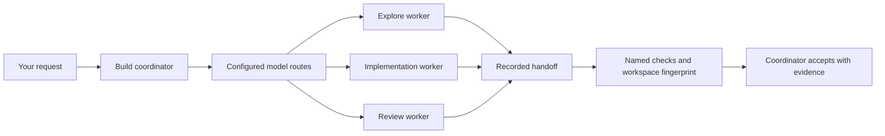

# OpenCode Model Orchestrator

Let your OpenCode Build model delegate work to other configured models, then verify the result before accepting it.

[](https://github.com/KevNev19/opencode-model-orchestrator/actions/workflows/ci.yml)

**Experimental alpha: `0.1.0-alpha.1`.** Suitable for developer trials in a disposable project. The orchestration lifecycle is tested with a real OpenCode server and a local model fixture. Comparative quality, speed and cost improvements with real providers are not established.

## What it does

Your chosen Build model remains the coordinator. It delegates bounded assignments to `explore`, `implement` and `review` workers using models available through your existing OpenCode providers.

- Route by role, with overrides based on the coordinator model.
- Prefer a different model for review when one is available in the route.
- Record the assignment, selected model, routing reason, handoff and reported usage.
- Permit one implementation writer per workspace, with bounded concurrency and retries.
- Preserve assignment identity across interruptions and reject duplicate dispatches.
- Run named verification commands, fingerprint the workspace, and require an explicit acceptance decision.

The focus is accountable delegation: **who did the work, what they were allowed to change, and what evidence supported acceptance**. Routing follows configured priorities; it does not learn the best model or automatically retry another provider after a failure.



Workers are native OpenCode child sessions. The plugin uses the host SDK client and [OpenCode plugin hooks](https://opencode.ai/docs/plugins/); provider credentials stay in your existing OpenCode setup.

## Requirements

- macOS or Linux. Windows is not supported by the verifier process lifecycle.
- Node.js **22.6 or newer**, npm and Git; `node` must be on `PATH`.
- **OpenCode 1.18.30**. This alpha targets that version; other versions are unverified. `doctor` checks for an exact match.
- At least one connected, tool-capable model. Multiple models are useful but not required for a first trial.

Use the [OpenCode CLI documentation](https://opencode.ai/docs/cli/) to set up provider access. Confirm `opencode --version` prints `1.18.30`, then use `opencode models` to find model IDs in `provider/model` form. Catalogue visibility alone does not prove that your account can call a model.

## First trial

The included greeting example has three acceptance tests. Its starter implementation intentionally fails two of them, giving the worker a small, observable change to make. It has no application dependencies.

Clone and build the plugin, then copy the example outside the plugin repository:

```sh
git clone https://github.com/KevNev19/opencode-model-orchestrator.git
cd opencode-model-orchestrator
npm ci
npm run build
export OMO_PLUGIN_DIR="$PWD"

cp -R examples/greeting ../omo-greeting-trial
cd ../omo-greeting-trial
```

Initialize with a real model ID from your own OpenCode configuration. Replace the placeholder before running this command:

```sh
node "$OMO_PLUGIN_DIR/dist/cli.js" init --model "provider/model"
```

This creates `orchestrator.json` and a local `.opencode/plugins/model-orchestrator.js` loader. It initially uses the selected model for every worker role. Your Build model is still selected separately in OpenCode.

Add the example's verification command:

```sh
node --input-type=module <<'JS'
import { readFileSync, writeFileSync } from "node:fs";
const config = JSON.parse(readFileSync("orchestrator.json", "utf8"));
config.checks = { test: ["node", "--test", "test/greet.test.mjs"] };
writeFileSync("orchestrator.json", JSON.stringify(config, null, 2) + "\n");
JS

node "$OMO_PLUGIN_DIR/dist/cli.js" doctor
opencode
```

Select **Build** and send this prompt:

> Use orchestrator_models to inspect the routes. Delegate an implementation assignment with key `greeting-v1`, allowed files `["src/greet.mjs"]`, and checks `["test"]`. Update greet(name) so ordinary names return "Hello, Ada!", surrounding whitespace is trimmed, and blank or missing names return "Hello, world!". Keep the tests unchanged. Inspect the worker handoff, run orchestrator_verify, and accept only when every criterion has evidence. If anything is blocked, report the assignment ID and reason.

Respond to OpenCode's normal permission prompts for delegation, edits and the configured check. Existing permission denials still apply.

When it finishes, inspect the result from your terminal:

```sh
npm test
node "$OMO_PLUGIN_DIR/dist/cli.js" status
node "$OMO_PLUGIN_DIR/dist/cli.js" report
```

**Expected result:** all three example tests pass; the implementation assignment has status `accepted`, passing verification and `verificationCurrent: true`. Its model and handoff are recorded. Worker prose alone is not evidence that the assignment was accepted.

Keep the plugin checkout at its original location: the generated loader points to its compiled plugin using an absolute file URL. This trial calls your configured provider and uses its normal billing or subscription limits.

## Configure different models

Edit the trial project's `orchestrator.json`, then restart OpenCode. Model IDs below are placeholders; use IDs you can access.

```json
{
  "routes": {
    "explore": { "models": ["provider/fast-model"] },
    "implement": {
      "models": ["provider/coding-model", "provider/fallback-model"],
      "byCoordinator": {
        "provider/build-model": ["provider/other-coding-model"]
      }
    },
    "review": {
      "models": ["provider/review-model", "provider/coding-model"],
      "preferDifferent": true
    }
  },
  "checks": { "test": ["node", "--test", "test/greet.test.mjs"] }
}
```

An override replaces the role's normal candidate list for that coordinator. Selection uses the first connected, tool-capable candidate. `preferDifferent` prefers a candidate different from the current coordinator; it is not a guarantee of independence from the implementation worker. Put a distinct reviewer first when that matters. If no candidate qualifies, dispatch fails without silently choosing an unconfigured model.

Other settings and defaults:

| Setting | Default | Purpose |
| --- | --- | --- |
| `maxConcurrent` | `3` | Maximum active assignments; only one implementation writer |
| `maxAttempts` | `2` | Total attempts per assignment, including the first |
| `timeoutMs` | `600000` | Worker request timeout; interrupted work retains ownership |
| `workerSteps` | `30` | Maximum worker steps |
| `checkTimeoutMs` | `120000` | Timeout per verification command |
| `verificationInputs` | `[]` | Additional workspace paths to fingerprint, including ignored inputs |

Checks are named argument arrays, such as `["npm", "test"]`. They run in the project directory without a shell. Define commands you trust: verification programs are ordinary local processes. At least one named check is required for implementation assignments.

Fingerprints include tracked and nonignored files plus explicit assignment paths and `verificationInputs`. `.git`, `.orchestrator` and `node_modules` are excluded. Passing checks must leave the fingerprint unchanged. Use a dependency lockfile and list any ignored fixtures or configuration that affect the result.

## Use it in an existing project

After completing the disposable trial, run the built CLI against the project root:

```sh
node "$OMO_PLUGIN_DIR/dist/cli.js" init --root /path/to/project --model "provider/model"
```

Set routes and verification commands in that project's `orchestrator.json`; the root [example configuration](orchestrator.example.json) is a starting point. Ignore `.orchestrator/` and the generated loader in version control. The loader contains a machine-specific path. Configuration can be committed if it contains only shareable model IDs, commands and paths; credentials belong in OpenCode.

Use one loading method. Do not also add the same plugin to `opencode.json` or a global plugin directory: OpenCode can load local and configured plugins separately. `init` refuses to overwrite existing configuration or its loader.

## Tools and lifecycle

| Tool | Purpose |
| --- | --- |
| `orchestrator_models` | Inspect routes, model capabilities and named checks |
| `orchestrator_delegate` | Dispatch a scoped assignment with a stable key |
| `orchestrator_status` | Inspect persisted assignments and evidence |
| `orchestrator_reconcile` | Inspect the owned child or recover stopped verification |
| `orchestrator_cancel` | Abort an owned child and confirm cancellation |
| `orchestrator_retry` | Resume a confirmed failed or cancelled assignment in the same child |
| `orchestrator_verify` | Run checks against a fingerprinted workspace |
| `orchestrator_accept` | Record acceptance with a written explanation of the evidence |

The normal path is `reserved → running → ready → verifying → ready → accepted`. A completed worker is `ready`; it has not accepted its own work. Verification requires all active workers to finish. Acceptance also requires no active work and a matching current fingerprint.

Reusing the same key and assignment returns its existing record. Reusing a key for different work is rejected. Retries inspect and reuse the original child because an earlier attempt may have changed files.

Assignments and transition history live in `.orchestrator/journal.jsonl`. Completed verification evidence has a separate recorded identity, allowing a restarted coordinator to recover it after the original coordinator dies. Corrupt records, ambiguous ownership and live processes block conflicting work.

## Limits and recovery

- **Managed mode affects the whole project while the plugin is loaded.** Coordinators delegate edits and use named checks instead of direct shell access. Workers cannot use shell tools, arbitrary MCP tools or nested delegation. Implementation writes are restricted to declared paths; read tools follow OpenCode permissions. This may conflict with other plugins or workflows.
- **This is not an operating-system sandbox.** OpenCode, language servers, other plugins, terminals and verification commands still run as local programs. The plugin does not isolate repositories, create worktrees, roll back edits or merge branches.
- **An interrupted worker retains ownership.** Ask Build to reconcile the assignment before starting overlapping work. A confirmed failed or cancelled child can be retried within the attempt limit. Unknown children remain blocked.
- **Unconfirmed cancellation cannot be recovered automatically.** If the abort response is lost, the public API keeps the assignment blocked even after restart. Do not delete its journal to force another writer. Stop the OpenCode process and owned verification processes, preserve the journal and edits, and report the issue. A fresh disposable copy can be used for another trial once the old processes are confirmed stopped.
- **Acceptance is a historical decision.** Later workspace changes can make `verificationCurrent` false. Passing commands do not prove semantic correctness; the coordinator must assess each criterion. A fresh assignment is appropriate for further work after acceptance.
- **Usage is partial.** `report` includes recorded worker executions, not coordinator usage, unfinished attempts or authoritative provider billing. Some token categories overlap. Zero reported cost does not establish free usage. There is no dollar-budget enforcement or comparative benchmark claim.

To disable the plugin, finish or stop all owned work, close OpenCode, and remove the generated `.opencode/plugins/model-orchestrator.js` loader. Keep `.orchestrator/` when you need the history. Removing the loader alone does not stop existing processes or revert files.

## Validation and development

```sh
npm ci
npm run check
```

The local suite covers routing, duplicate dispatch, ownership, stale transitions, write restrictions, ignored verification inputs, retries, cancellation ordering, lock recovery, verifier crash recovery and CLI behavior. Without `OPENCODE_TEST_BINARY`, the two OpenCode integration tests are skipped.

Run the full suite against the pinned runtime:

```sh
OPENCODE_TEST_BINARY="$(command -v opencode)" npm run check
```

Integration starts isolated OpenCode servers and a deterministic local model endpoint. It tests delegation to a different model ID, a real file edit, verification, acceptance and inherited read restrictions. It uses no paid model API. It does not establish which real models follow the instructions best.

CI runs the full suite on macOS and Linux with a pinned OpenCode runtime. The greeting example deliberately starts with failing acceptance tests and is separate from the plugin's test suite.

| Source | Responsibility |
| --- | --- |
| [`src/plugin.ts`](src/plugin.ts) | OpenCode hooks, worker agents and tools |
| [`src/orchestrator.ts`](src/orchestrator.ts) | Admission, transitions and acceptance |
| [`src/opencode.ts`](src/opencode.ts) | Native child sessions and model catalogue |
| [`src/store.ts`](src/store.ts) | Durable journal and process locking |
| [`src/guard.ts`](src/guard.ts) | Managed tool and write-path restrictions |
| [`src/verification.ts`](src/verification.ts) | Verification process ownership and recovery |
| [`src/workspace.ts`](src/workspace.ts) | Fingerprints and command execution |

Build a distributable with `npm pack`. GitHub alpha releases include an npm-compatible tarball; this project is not published to the npm registry.

## Share trial feedback

Open a [trial feedback issue](https://github.com/KevNev19/opencode-model-orchestrator/issues/new?template=trial-feedback.yml) with your operating system, Node/OpenCode versions, coordinator and worker model IDs, assignment outcome, elapsed time and any permission or recovery problems. For a comparison, repeat the same task from the same starting files with one model and use external provider usage records for total cost.

Review and redact logs before posting. Journal records can contain prompts, code excerpts, paths, tool output and provider responses. Never include credentials or private project content in a public issue.

Use [bug reports](https://github.com/KevNev19/opencode-model-orchestrator/issues/new?template=bug-report.yml) for reproducible defects. Keep changes focused and include the relevant test results.

## License

[MIT](LICENSE).
